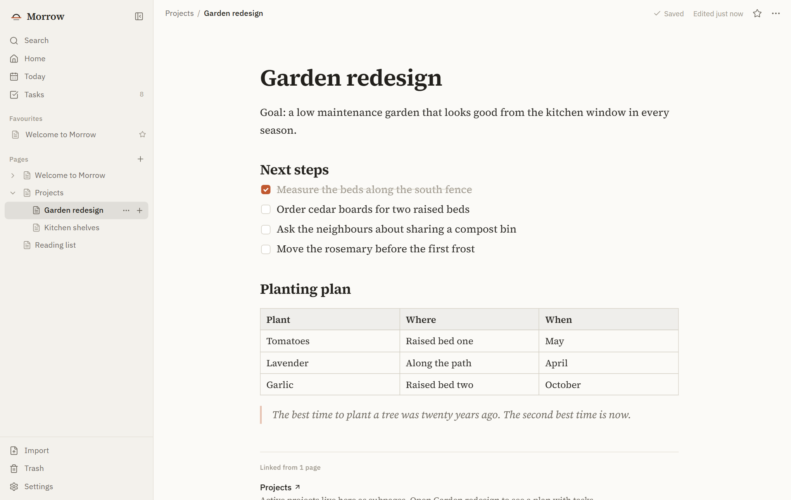
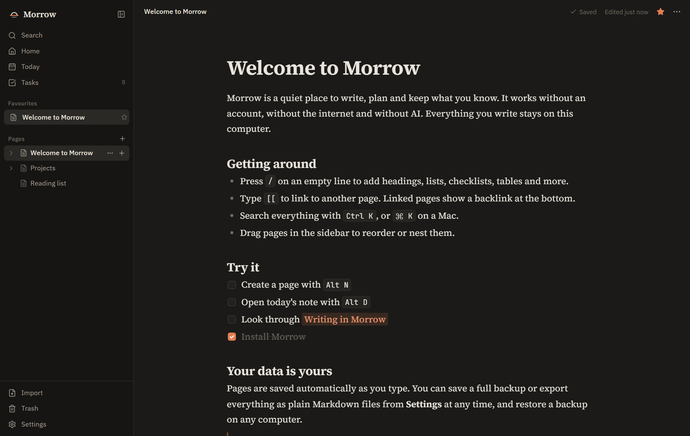
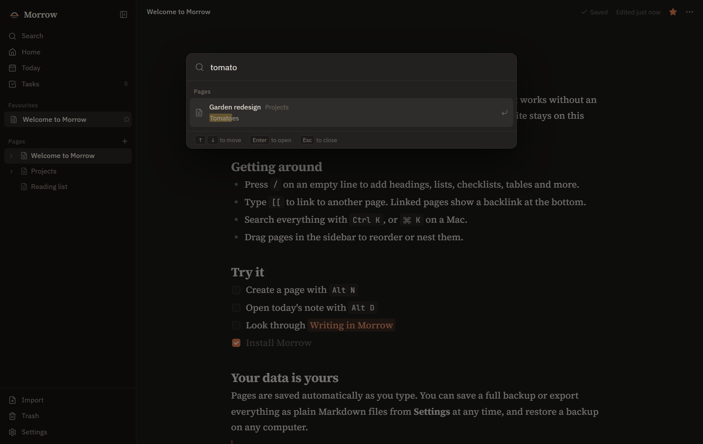

# Morrow

Morrow is a free, open source, local first workspace for your notes, ideas and
projects. No account, no subscription, no cloud and no AI. Just a calm place to
write and think, on your own computer.



## Why Morrow

- **Yours.** Pages live on your computer. Nothing is sent anywhere: no accounts,
  no telemetry, no ads. It works with the network cable unplugged.
- **Calm.** A focused writing surface with careful typography, and only the
  features that earn their place.
- **Trustworthy.** Every change is saved automatically and the status is always
  visible. Failed writes are kept and retried, content Morrow cannot read is
  protected instead of overwritten, and the trash never empties itself.
- **Portable.** Export a page or the whole workspace as plain Markdown, save a
  full backup in one file and restore it on any computer.
- **AI free, by design.** Morrow does not have AI features and will not add them.

## Features

- Nested pages in a sidebar tree, with drag and drop, favourites and a trash
- A rich text editor: headings, bold, italic, underline, strikethrough, code,
  bulleted, numbered and nested lists, checklists, quotes, code blocks,
  dividers, links and tables
- `/` to insert any block, Markdown shortcuts as you type, Markdown paste
- `[[` to link pages, with titles that stay current and backlinks on every page
- Daily notes, and a Tasks view that gathers every checklist item
- Search across titles and text with highlighted results, and a command palette
- Light and dark themes, a choice of serif, sans or mono writing fonts
- Markdown import and export, full JSON backups, automatic rolling backups
- A native desktop window with the system's own window controls
- Keyboard first: press Ctrl/Cmd + / to see every shortcut

| Dark theme                                             | Search                                                            |
| ------------------------------------------------------ | ----------------------------------------------------------------- |
|  |  |

## Build and run

You need [Node.js](https://nodejs.org) 20.19 or newer.

```sh
git clone https://github.com/Aarav2709/Morrow.git
cd Morrow
npm install
npm run dev        # opens the desktop app with live reload
```

| Command           | What it does                                           |
| ----------------- | ------------------------------------------------------ |
| `npm run dev`     | Desktop app with live reload                           |
| `npm run dev:web` | The interface in your browser at http://localhost:5173 |
| `npm run build`   | Builds the interface and the desktop shell             |
| `npm start`       | Runs the built desktop app                             |
| `npm run dist`    | Builds installers for your platform into `release/`    |

On Windows `npm run dist` produces `Morrow-Setup-<version>.exe` and a portable
`.exe`. macOS and Linux targets are configured but have not been tested yet.
Builds are not code signed, so Windows SmartScreen and macOS Gatekeeper will
warn the first time you open them.

## Where your data lives

Everything is stored in Morrow's data folder: `%APPDATA%\Morrow` on Windows,
`~/Library/Application Support/Morrow` on macOS and `~/.config/Morrow` on Linux.
Settings has a button that opens it. Automatic backups are kept in the `Backups`
folder inside it. Backups are a single readable JSON file, and Markdown exports
are plain text files that open in any editor.

## Licence

Morrow is licensed under the [Apache License 2.0](LICENSE). The licences of the
open source packages it bundles are written to `THIRD_PARTY_LICENSES.txt` in
every build.
