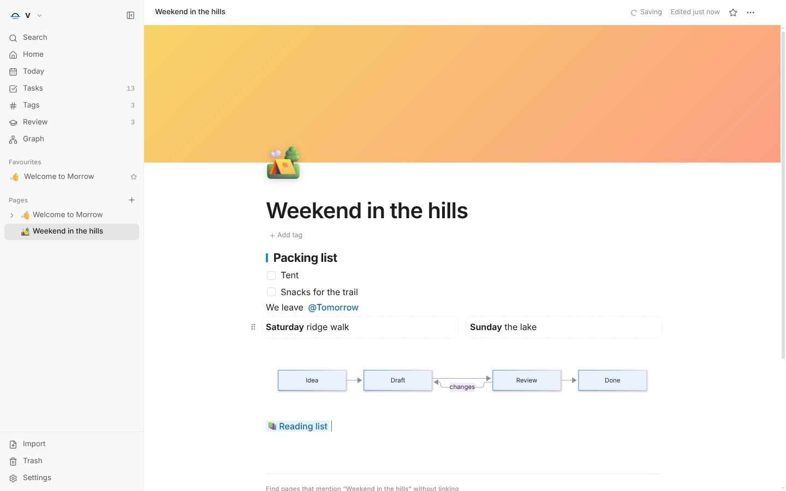

# Morrow

Morrow is a free, open source, local first workspace for your notes, databases
and ideas. Every page is a plain Markdown file in a folder you choose. No
account, no subscription, no cloud and no AI. Just a calm place to write and
think, on your own computer.



## Why Morrow

- **Yours.** Your notes are a folder of Markdown files. Open them in any app,
  sync them with Syncthing, iCloud, Dropbox or git, and keep them forever. Edits
  made elsewhere show up in Morrow straight away. Nothing is sent anywhere: no
  accounts, no telemetry, no ads. It works with the network cable unplugged.
- **Calm.** A focused writing surface with careful typography, and only the
  features that earn their place.
- **Trustworthy.** Morrow only rewrites a file you changed in Morrow. Every
  change is saved as you type, failed writes are retried, earlier versions of
  every page are kept, a file changed elsewhere while you were editing is kept
  in page history, and deleted pages go to the system trash.
- **Compatible.** Wiki links, callouts, tags, properties, maths and canvases use
  the same formats as Obsidian, so an existing vault opens as it is. Notion
  exports, databases included, import in one step.
- **AI free, by design.** Morrow does not have AI features and will not add them.

## Features

- **Pages** in a sidebar tree with icons, drag and drop, favourites and a trash
- **A rich editor**: headings, lists, checklists, quotes, callouts with titles
  and folding, toggles, tables, highlights, maths, syntax highlighted code,
  images and file attachments
- **Links**: `[[` to link pages, with aliases and headings, live titles,
  backlinks, links to pages that do not exist yet, and links that follow renames
- **Databases**: table, board, calendar, list and gallery views of pages, with
  text, number, select, multi-select, date, checkbox and link properties,
  filters, sorts and grouping. Row values are readable frontmatter.
- **Canvases**: an infinite whiteboard of cards, pages, images and groups joined
  by arrows, saved as open JSON Canvas files
- **Graph**: every page and link as a network, or the neighbourhood of one page
- **Tags** from properties or `#tags` in text, with nested tags and a tag index
- **Templates** with `{{date}}`, `{{time}}` and `{{title}}`, and a daily note
  template
- **Daily notes**, and a Tasks view that gathers every checklist item
- **Search** across every page, with `#tag` filters, and a command palette
- **Vaults**: open any folder, switch between folders, keep work and home apart
- Find and replace, Markdown shortcuts, Markdown paste, page history
- Import from Notion (pages and databases) or any folder of Markdown files,
  export to Markdown, full backups
- Light and dark themes, a choice of serif, sans or mono writing fonts
- Keyboard first: press Ctrl/Cmd + / to see every shortcut
- An installable web version that works offline

## Status

Version **1.0.0**. Pages are files in a folder you choose. Earlier builds kept
them inside the app; the first time this version opens it offers to copy those
pages into the folder and leaves the original copy untouched. The macOS and Linux builds
are produced by the release workflow but have not yet been tried on real
machines, and builds are not code signed yet.

## Coming from Obsidian

Choose **Open a folder** and pick your vault. Morrow reads it as it is: folders,
wiki links, embeds, callouts, tags, properties, aliases, maths and canvases.
Nothing in `.obsidian` is touched, and files you do not edit in Morrow are never
rewritten.

## Coming from Notion

In Notion, open Settings, Export, choose **Markdown & CSV** and include
subpages. In Morrow, choose **Import** in the sidebar and pick the zip file.
Pages keep their nesting, links between pages and images, databases become
Morrow databases with their properties, and Notion's callouts become Morrow
callouts.

## Build and run

You need [Node.js](https://nodejs.org) 20.19 or newer.

```sh
git clone https://github.com/Aarav2709/Morrow.git
cd Morrow
npm install
npm run dev        # opens the desktop app with live reload
```

| Command           | What it does                                           |
| ----------------- | ------------------------------------------------------ |
| `npm run dev`     | Desktop app with live reload                           |
| `npm run dev:web` | The interface in your browser at http://localhost:5173 |
| `npm run build`   | Builds the interface and the desktop shell             |
| `npm start`       | Runs the built desktop app                             |
| `npm run dist`    | Builds installers for your platform into `release/`    |
| `npm test`        | Runs the unit and storage tests                        |
| `npm run check`   | Type check, lint, tests and build together             |

On Windows `npm run dist` produces `Morrow-Setup-<version>.exe` and a portable
`.exe`. Pushing a tag such as `v1.0.0` builds Windows, macOS and Linux versions
on GitHub and attaches them to a release. Morrow never checks for updates on
its own; new versions are downloaded from the releases page. Builds are signed automatically once the
signing secrets (`CSC_LINK` and `CSC_KEY_PASSWORD`, plus `APPLE_ID`,
`APPLE_APP_SPECIFIC_PASSWORD` and `APPLE_TEAM_ID` for macOS) are added to the
repository. Until then Windows SmartScreen and macOS Gatekeeper warn the first
time Morrow is opened.

## Where your data lives

In the folder you chose, as Markdown files. The format, including frontmatter,
databases, canvases and the small `.morrow` folder Morrow keeps beside your
pages, is documented in [docs/data-format.md](docs/data-format.md), and every
1.x release will keep reading it. Morrow's own settings and automatic backups of
your pages live in `%APPDATA%\Morrow` on Windows, `~/Library/Application
Support/Morrow` on macOS and `~/.config/Morrow` on Linux. The browser version
keeps pages in the browser's storage instead.

## Licence

Morrow is licensed under the [Apache License 2.0](LICENSE). The licences of the
open source packages it bundles are written to `THIRD_PARTY_LICENSES.txt` in
every build.
